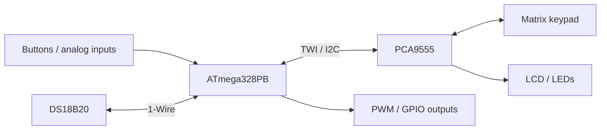

# AVR Microcontroller Labs

**Register-level embedded programming with the ATmega328PB**
Microprocessor laboratory coursework · National Technical University of Athens

C and AVR Assembly exercises exploring how software interacts with hardware: bit operations and interrupt handling, analog acquisition, I²C peripherals and temperature sensing.

The collection contains **seven laboratory folders and 26 source files**, including alternative versions. Each lab page explains its application and control flow so the work can be understood without opening the code.

## Explore the work

| Lab | Application | Main techniques |
| :--- | :--- | :--- |
| [01 · Assembly fundamentals](lab-01/README.md) | Timed routines, Boolean functions and a moving LED | Registers, stack, shifts, T flag, cycle counting |
| [02 · External interrupts](lab-02/README.md) | Event counters and a restartable lamp sequence | INT0/INT1, ISRs, shared flags, interruptible delays |
| [03 · PWM and analog input](lab-03/README.md) | Button-controlled PWM and ADC indicators | Timer 1, OC1A, ADC, sample averaging |
| [04 · Analog acquisition and display](lab-04/README.md) | LCD output and a gas-concentration monitor exercise | Timer interrupts, ADC, threshold logic, 4-bit LCD |
| [05 · I²C peripherals](lab-05/README.md) | Logic outputs, keypad input and LCD via a port expander | TWI transactions, register addressing, PCA9555 |
| [06 · Matrix keypad applications](lab-06/README.md) | Key display and a two-digit combination exercise | Row scanning, debouncing, edge detection, state machine |
| [07 · Temperature sensing](lab-07/README.md) | DS18B20 presence detection and temperature display | Bit-banged 1-Wire, signed data, I²C LCD |

## A closer look

**Interrupt-driven behavior.** Lab 2 uses external interrupts to signal events to the main program. The revised lamp implementation checks for a restart during its delay rather than waiting until the complete sequence ends.

**Peripheral integration.** Labs 5 and 6 access PCA9555 registers through the AVR TWI peripheral. Keypad rows are driven individually, column inputs are decoded, and the results control LEDs or an LCD.

**From sensor to display.** Lab 7 implements the timing and command sequence for a DS18B20, then combines acquisition with signed-temperature formatting and an LCD connected through the I²C expander.

*This diagram summarizes interfaces across the collection. Each exercise uses a different subset and pin assignment.*

## Hardware and source organization

- **Target:** ATmega328PB; source generally assumes a 16 MHz clock.
- **Languages:** C and AVR Assembly using AVR headers and assembler definitions.
- **Peripherals:** GPIO, timers, ADC, external interrupts, TWI/I²C and software 1-Wire.
- **Build one subexercise at a time.** Each has its own entry point. Lab 4.3 additionally links the LCD driver.

[Build and hardware setup →](docs/BUILD.md)

## Verification status

**The laboratory work was implemented collaboratively, tested on the course hardware, and assessed during the course.** This repository was assembled later from the saved source archive; no new hardware run was performed when preparing it.

The archive contains alternative and intermediate versions. Historical course testing does not establish that every saved variant is the exact version used in the assessment. Timing values describe source settings, not newly measured performance.

Known issues in the saved variants are recorded in the lab pages, including the unassigned averaging expression in Lab 3.3. Lab 8 was part of the coursework, but its complete final firmware has not yet been recovered: the saved main file stops at an LCD test and leaves the application flow commented out.

[Verification plan and known limitations →](docs/VERIFICATION.md)

## Academic context and attribution

Developed collaboratively as coursework at the School of Electrical and Computer Engineering, NTUA. Repository prepared from the archive of **Theodoros Rimagmos**.

The laboratory summaries use original English wording based on the implementations. Course handouts, reference reports and vendor device packs are not redistributed.
