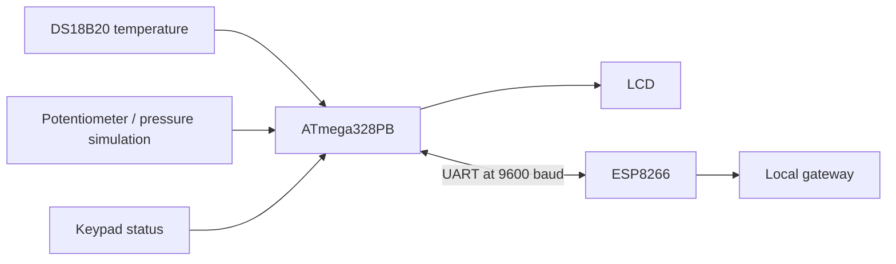

# Lab 08 · UART and an IoT monitoring exercise

**ATmega328PB → UART → ESP8266 → local gateway**

This course exercise brings together the earlier sensor, keypad and display work with serial communication. The course report describes an educational patient-monitoring scenario: acquire temperature, simulate pressure with a potentiometer, select a status from the keypad, and send a structured payload to a gateway through an ESP8266.

The laboratory work was tested and assessed during the course. The files recovered here are an intermediate development snapshot; they should not be mistaken for the exact final firmware used in the assessment.

## Exercise overview

| Part | Goal | What the recovered material contains |
| :--- | :--- | :--- |
| 8.1 · Connection | Configure UART, connect the ESP8266 and select a gateway URL | UART helper calls, Success/Fail response handling and the saved connection sequence |
| 8.2 · Acquisition | Read temperature and simulated pressure; select a status | DS18B20 calls, ADC averaging and conversion, keypad decoding and LCD formatting |
| 8.3 · Transmission | Format readings and send them to the gateway | JSON payload formatting and ESP:payload / ESP:transmit commands |

## Data flow

The source specifies a 16 MHz MCU clock and a UART divider of 103 for nominal 9600 baud. Pressure is an exercise conversion from ADC input, not a calibrated physiological measurement. The application is coursework, not a clinically validated system.

## Recovered files

| File | Original archive name | Role |
| :--- | :--- | :--- |
| [main.c](main.c) | main.txt | Application helpers and saved main function |
| [lcd_twi.c](lcd_twi.c) | source.txt | TWI transactions, PCA9555 access, LCD and keypad routines |
| [lcd_twi.h](lcd_twi.h) | header.txt | Interface declarations |

These three files were found in the parent course folder and matched to Lab 8 by their includes, commands and correspondence with the report. Their original contents were preserved; only the repository filenames identify their intended C/header roles.

## State of this snapshot

The active main function initializes TWI and the LCD, displays `Success!!`, and then stays in an infinite loop. UART and ADC initialization are disabled. The subsequent connection, acquisition and transmission sequence is inside a block comment.

`Success!!` therefore identifies the LCD test in this source; it does not demonstrate network connection or payload delivery. Helpers for the intended application remain visible above main.

The includes `USART.h` and `owi_ds18b20.h`, and their corresponding implementations, were not recovered with these files. The header also contains static declarations for functions implemented with different linkage in the C file. Restoring the final program requires checking those interfaces as well as restoring the application flow; simply uncommenting it is insufficient.

## Evidence and restoration

A future demonstration can show gateway receipt of synthetic readings alongside the LCD, then exercise ESP connection failure and sensor-disconnection cases. Record the actual firmware version and board setup. No fresh build or end-to-end run of this intermediate snapshot is claimed.

[Build notes](../docs/BUILD.md) · [Verification notes](../docs/VERIFICATION.md) · [Back to collection](../README.md)
